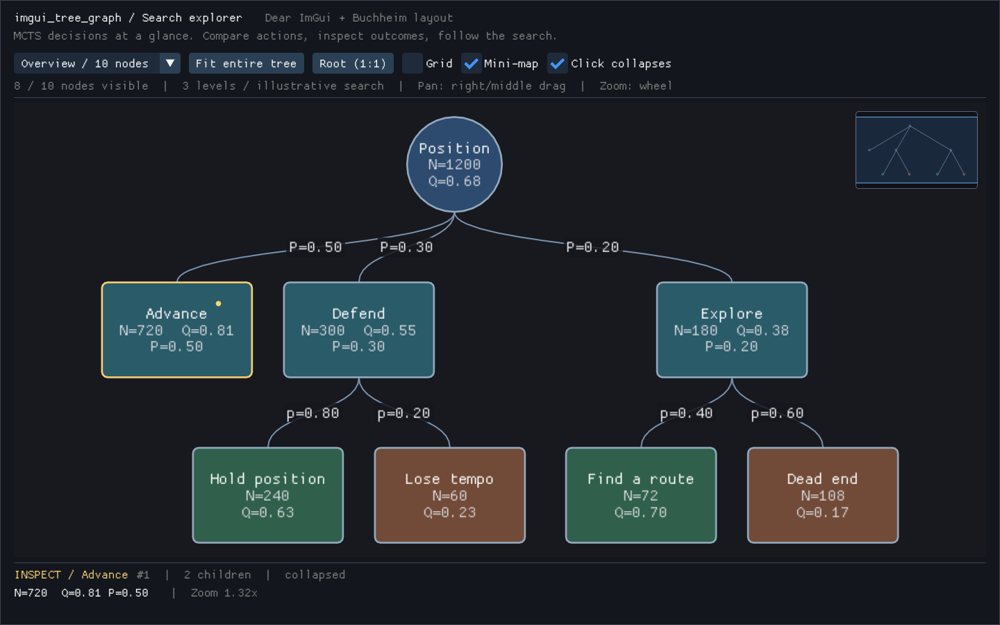

# imtree

**Explorez vos arbres de recherche dans Dear ImGui.**

imtree est un addon C++20 pour [Dear ImGui](https://github.com/ocornut/imgui)
qui visualise les décisions de vos algorithmes :
états, actions, probabilités et scores, directement dans vos outils de debug.
Le layout place les nœuds ; vous naviguez dans l’arbre et inspectez ce qui compte.


*Une position, trois actions, six issues : l’arbre tient en entier à l’écran.
Les arêtes portent les probabilités et chaque nœud affiche ses métriques.*

## Du résultat à la décision

- **Comprendre une recherche.** Affichez les visites, valeurs et probabilités de
  votre MCTS, minimax ou planificateur à côté des décisions qui les produisent.
- **Explorer sans perdre le fil.** Zoom sous le curseur, déplacement, cadrage
  automatique et mini-map pour retrouver sa position.
- **Isoler une branche.** Repliez les sous-arbres au clic sans réinitialiser
  la caméra.
- **Brancher votre inspecteur.** Récupérez le nœud cliqué ou survolé, le bouton,
  les modificateurs et la position dans le canvas.
- **Adapter le rendu à vos données.** Labels multilignes, couleurs par nœud ou
  callback, formes et cartouches d’arêtes.



*Le même arbre, une branche repliée. La sélection reste disponible pour votre
inspecteur, indépendamment du repliage.*

## Essayez la démo

La démo inclut le petit arbre ci-dessus et un arbre MCTS de neuf niveaux.
Dear ImGui et GLFW sont récupérés automatiquement par CMake.

**Linux / Debian / Ubuntu**

```sh
sudo apt-get install cmake g++ git libgl1-mesa-dev libxrandr-dev libxinerama-dev libxcursor-dev libxi-dev
cmake -S . -B build -DCMAKE_BUILD_TYPE=Release
cmake --build build --config Release --parallel
./build/imgui_tree_graph_demo
```

**Windows :** mêmes commandes CMake avec Visual Studio 2022 et ses outils C++,
puis `build/Release/imgui_tree_graph_demo.exe`.
**macOS :** Xcode Command Line Tools ; mêmes commandes CMake.

Prérequis : CMake ≥ 3.24, Git, C++20 et OpenGL ≥ 3.2 pour la démo.
Le premier téléchargement nécessite Internet ; `CPM_SOURCE_CACHE` permet de
réutiliser les dépendances.

Le sélecteur de scène permet de passer du petit arbre au grand MCTS.
Pour ouvrir directement une vue :

```sh
./build/imgui_tree_graph_demo --scene overview --view fit
./build/imgui_tree_graph_demo --scene overview --view fit --collapse-first
./build/imgui_tree_graph_demo --scene large --view root
```

| Geste | Action |
| --- | --- |
| Molette | Zoomer autour du curseur |
| Glisser avec le bouton droit ou central | Déplacer la vue |
| Clic gauche sur un nœud | Sélectionner et replier/déplier |
| Clic/glisser dans la mini-map | Recentrer la vue |
| Fit entire tree | Cadrer l’arbre visible |
| Click collapses désactivé | Sélectionner sans replier |

## Votre premier arbre

Construisez le modèle une fois, puis affichez-le dans votre boucle ImGui :

```cpp
#include <imgui_tree_graph/TreeRenderer.hpp>

using namespace ImGuiTreeGraph;

// Initialisation : conserver le modèle et le renderer entre les frames.
auto root = std::make_unique<BuchheimNode>("Position");
auto move = std::make_unique<BuchheimNode>("Avancer");
move->shape = NodeShape::RoundedRectangle;
move->secondary_label = "N=42\nQ=0.7";
move->edge_from_parent.label = "p=0.8";
root->add_child(std::move(move));

LayoutConfig layout;
ComputeBuchheimLayout(root.get(), layout);
TreeRenderer renderer;

// À chaque frame :
ImGui::Begin("Recherche");
renderer.render("tree", root.get(), layout);
if (const auto* node = renderer.interaction().hovered) {
    ImGui::BeginTooltip();
    ImGui::TextUnformatted(node->secondary_label.c_str());
    ImGui::EndTooltip();
}
ImGui::End();
```

`BuchheimNode` possède ses enfants et ses labels. Après une modification de la
structure ou des paramètres de layout, rappelez `ComputeBuchheimLayout`.
Le premier rendu d’un arbre neuf et le repliage interactif calculent le layout
automatiquement.

## Intégration

La bibliothèque utilise Dear ImGui ; GLFW et OpenGL ne servent qu’à la démo.
Vous pouvez fournir la cible ImGui de votre application :

```cmake
set(IMGUI_TREE_GRAPH_BUILD_DEMO OFF CACHE BOOL "" FORCE)
set(IMGUI_TREE_GRAPH_BUILD_TESTS OFF CACHE BOOL "" FORCE)
set(IMGUI_TREE_GRAPH_IMGUI_TARGET my_imgui CACHE STRING "" FORCE)
add_subdirectory(external/imtree)
target_link_libraries(my_app PRIVATE ImGuiTreeGraph::imgui_tree_graph)
```

Sans cible externe, CMake récupère Dear ImGui **v1.91.9b**
(et GLFW **3.4** pour la démo).

## API et personnalisation

| API | Rôle |
| --- | --- |
| `BuchheimNode::add_child` | Transférer un enfant et établir son parent et son indice |
| `LayoutConfig` | Dimensions des nœuds et espacement des niveaux/sous-arbres |
| `RendererConfig` | Grille, mini-map, seuils de détail et limites du zoom |
| `TreeRenderer::camera()` | Accéder au déplacement et au zoom |
| `TreeRenderer::fit_to_tree()` | Cadrer les nœuds visibles |
| `TreeRenderer::interaction()` | Lire le survol, le clic, le double-clic et les modificateurs |
| `RendererConfig::node_color` | Fournir une palette personnalisée au canvas et à la mini-map |

Une couleur `fill_color` non nulle est prioritaire sur le callback et la palette
J1/J2/chance. `collapse_on_click = false` réserve le clic à la sélection.
Les pointeurs d’interaction sont empruntés et les événements réinitialisés à
chaque rendu : conservez le modèle en vie, sans le modifier pendant le dessin.

Les en-têtes constituent la référence de l’API :
[`BuchheimLayout.hpp`](include/imgui_tree_graph/BuchheimLayout.hpp) ·
[`TreeRenderer.hpp`](include/imgui_tree_graph/TreeRenderer.hpp).
La [démo](examples/demo.cpp) montre leur utilisation avec GLFW/OpenGL3.

## Performances et périmètre

Le placement utilise l’algorithme de Buchheim–Jünger–Schulz en **O(N)**.
Le rendu évite les primitives hors écran et simplifie formes, textes et
cartouches au dézoom. Après préchauffage des buffers ImGui, le renderer
n’alloue pas par frame, hors allocations éventuelles de votre callback.

Le parcours CPU reste linéaire en nombre de nœuds non masqués par le repliage,
y compris pour la mini-map : ce n’est pas un index spatial. Le modèle possède
des nœuds alloués individuellement ; il n’offre pas encore de pool plat,
d’adaptateur zéro copie ni de regroupement automatique en clusters.

> **Backend ImGui :** avec les indices 16 bits, activez
> `ImGuiBackendFlags_RendererHasVtxOffset` (déjà pris en charge par le backend
> OpenGL3 de la démo), ou compilez ImGui et ses consommateurs avec des indices
> 32 bits. Le renderer refuse de dessiner si aucune option n’est disponible.

<details>
<summary>Détails du modèle et du cadrage</summary>

- Les enfants doivent être non nuls. `add_child` refuse les pointeurs nuls.
  Après édition d’un arbre déjà calculé, même via `add_child`, le recalcul
  explicite reste nécessaire.
- Le modèle représente un arbre, pas un graphe : déroulez les cycles et les
  états partagés en occurrences distinctes. Les identifiants sont des métadonnées
  et ne doivent pas nécessairement être uniques.
- Les dimensions sont uniformes, en unités monde. Un cercle utilise la plus
  petite dimension comme diamètre ; `level_height` sépare les centres des niveaux.
  La racine est ancrée à `(0,0)` et les bornes incluent les formes visibles.
- Le déplacement de caméra est exprimé en pixels locaux du canvas.
  Une limite de zoom minimal trop élevée peut empêcher le cadrage d’un grand arbre.
- La surcharge mutable de `fit_to_tree` initialise le layout d’un arbre neuf.
  La surcharge constante cadre les coordonnées existantes sans mutation ; sur
  un arbre neuf, elle utilise un stockage temporaire O(profondeur).

</details>

<details>
<summary>Captures de la démo</summary>

Les deux images proviennent de la démo compilée, exécutée en 1440 × 900.
La seconde utilise `--collapse-first` pour montrer le repliage et l’inspecteur.
Sous Linux, avec `xvfb`, `xauth`, `xdotool` et ImageMagick installés, cette commande capture
la vue complète (ajoutez `--collapse-first` pour l’autre vue) :

```sh
xvfb-run -a -s '-screen 0 1440x900x24' sh -c '
  LIBGL_ALWAYS_SOFTWARE=1 ./build/imgui_tree_graph_demo --scene overview --view fit &
  demo=$!
  trap "kill $demo 2>/dev/null || true" EXIT
  sleep 8
  kill -0 "$demo" || exit 1
  xdotool mousemove --sync 1439 899
  sleep 1
  import -window root docs/images/imgui-tree-graph-demo.png
'
```

</details>

<details>
<summary>Tests et installation</summary>

```sh
ctest --test-dir build -C Release --output-on-failure
cmake --install build --prefix /your/prefix
```

Les tests couvrent le layout et le renderer, sans framework externe. La CI
compile sous Linux, Windows et macOS, vérifie l’installation et démarre la démo
sous Xvfb/Mesa. Un job Linux utilise AddressSanitizer/UBSan.

L’installation exporte `ImGuiTreeGraph::imgui_tree_graph` dans
`lib/cmake/imgui_tree_graph/imgui_tree_graphTargets.cmake`. Fournissez les includes
et le linkage de votre propre Dear ImGui, avec une configuration ABI compatible.
Pour compiler la démo avec une cible ImGui externe, renseignez aussi
`IMGUI_TREE_GRAPH_IMGUI_SOURCE_DIR`.

</details>
