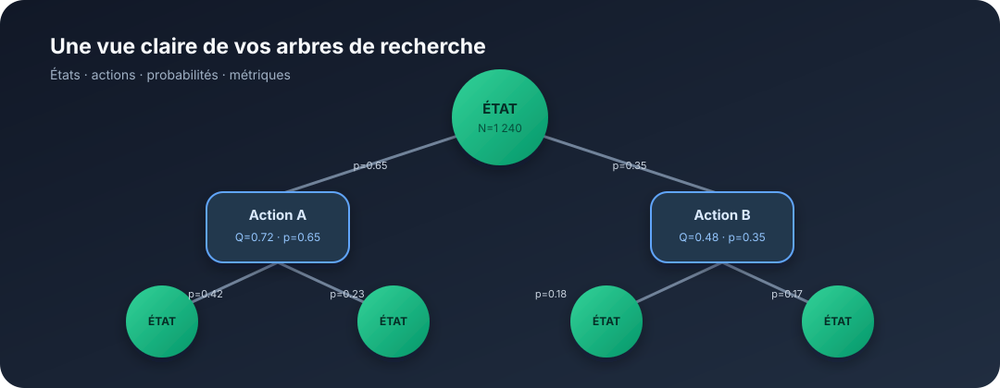

# imgui_tree_graph

[](https://github.com/toxicbloud/imtree/actions/workflows/ci.yml)
[](https://en.cppreference.com/w/cpp/20.html)
[](https://cmake.org/)
[](https://github.com/toxicbloud/imtree/actions/workflows/ci.yml)

**Visualisez et explorez des arbres de décision directement dans Dear ImGui.**
`imgui_tree_graph` transforme un arbre de recherche en vue interactive : états,
actions, probabilités et métriques restent lisibles même sur de grands arbres.



## Ce que vous pouvez faire

- Parcourir des arbres de recherche de gauche à droite, avec des états ronds et des actions rectangulaires.
- Déplacer la vue, zoomer sur une zone et replier les branches qui ne vous intéressent pas.
- Garder une vue d’ensemble grâce à la mini-carte et au cadrage automatique.
- Afficher des informations sur les nœuds et les transitions, comme le nombre de visites, la valeur ou la probabilité.
- Intégrer le rendu à une application Dear ImGui existante.

## Essayer la démo

Il faut CMake 3.24 ou plus récent, un compilateur C++20 et une connexion Internet
pour la première configuration. Dear ImGui et GLFW sont téléchargés automatiquement.

### macOS

Installez les outils en ligne de commande Xcode (`xcode-select --install`), puis CMake
(par exemple avec `brew install cmake`). La démo utilise OpenGL 3.2, disponible sur macOS.

### Ubuntu et Debian

```sh
sudo apt-get install cmake g++ git libgl1-mesa-dev libxrandr-dev libxinerama-dev libxcursor-dev libxi-dev
```

### Windows

Utilisez Visual Studio 2022 avec les outils de développement C++ et CMake.

### Construire et lancer

Sur macOS, Linux et Windows, depuis la racine du dépôt :

```sh
cmake -S . -B build -DCMAKE_BUILD_TYPE=Release
cmake --build build --config Release --parallel
ctest --test-dir build -C Release --output-on-failure
```

Lancez ensuite la démo :

```sh
# macOS et Linux
./build/imgui_tree_graph_demo

# Windows
build\Release\imgui_tree_graph_demo.exe
```

La démo affiche un arbre de recherche à neuf niveaux. Pour l’explorer :

| Action | Commande |
| --- | --- |
| Déplacer l’arbre | Glisser avec le bouton droit ou central |
| Zoomer ou dézoomer | Molette, centrée sur le curseur |
| Déplier ou replier une branche | Clic gauche sur un nœud |
| Recentrer la vue | Cliquer-glisser dans la mini-carte |
| Voir tout l’arbre | Bouton « Fit entire tree » |
| Revenir à la racine | Bouton « Root (1:1) » |

## Intégrer à votre application

La bibliothèque fournit le calcul du layout et le rendu ImGui. La démo GLFW/OpenGL
est facultative : elle peut être désactivée si votre application possède déjà sa
propre fenêtre et son backend Dear ImGui.

<details>
<summary>Exemple CMake et C++</summary>

```cmake
set(IMGUI_TREE_GRAPH_BUILD_DEMO OFF CACHE BOOL "" FORCE)
set(IMGUI_TREE_GRAPH_BUILD_TESTS OFF CACHE BOOL "" FORCE)
# Facultatif : utiliser votre cible Dear ImGui existante, plutôt que CPM.
set(IMGUI_TREE_GRAPH_IMGUI_TARGET my_imgui CACHE STRING "" FORCE)
add_subdirectory(external/imtree)
target_link_libraries(my_app PRIVATE ImGuiTreeGraph::imgui_tree_graph)
```

```cpp
#include <imgui_tree_graph/TreeRenderer.hpp>

using namespace ImGuiTreeGraph;
auto root = std::make_unique<BuchheimNode>();
root->primary_label = "Root";
auto child = std::make_unique<BuchheimNode>();
child->shape = NodeShape::RoundedRectangle;
child->secondary_label = "N=42\nQ=0.7";
child->edge_from_parent.label = "p=0.8";
root->children.push_back(std::move(child));
LayoutConfig layout;
ComputeBuchheimLayout(root.get(), layout);
TreeRenderer renderer; // persistant, un par canvas

// À chaque frame, entre ImGui::Begin(...) et ImGui::End() :
renderer.render("search", root.get(), layout);
```

Les structures possèdent les chaînes (`std::string`) et les enfants
(`std::unique_ptr`). Les pointeurs parent, contours et indices sont non propriétaires
et recalculés automatiquement. Un arbre est requis : les graphes avec cycles ou
états partagés doivent être déroulés en occurrences distinctes. Les identifiants
sont des métadonnées ; aucune unicité n’est requise pour le rendu.

Après une modification structurelle ou des paramètres de layout, appeler
`ComputeBuchheimLayout` avant le rendu. Le repliage par le renderer le fait
automatiquement. Conserver le modèle pendant le rendu, sans modification concurrente.
Les dimensions sont uniformes, en unités monde ; un cercle utilise la plus petite
dimension comme diamètre. `level_height` est la distance entre centres de niveaux :
choisir une valeur supérieure à `node_height` pour laisser de la place aux arêtes.
La racine est ancrée à `(0,0)`. Les bornes incluent les dimensions des nœuds visibles.

`RendererConfig` configure la grille, la taille et les quatre coins de mini-map,
les limites de zoom et les seuils LOD. `camera()` expose pan (pixels locaux du
canvas) et zoom. `fit_to_tree` ajuste la caméra aux dimensions disponibles.
`fill_color == 0` sélectionne la palette J1/J2/chance ; toute autre couleur
`ImU32` remplace cette palette.

</details>

## Qualité et compatibilité

La compilation et les tests sont vérifiés automatiquement sur **Linux, Windows et
macOS**. Sous Linux, la CI démarre également la démo sans écran avec Xvfb/Mesa et
exécute les tests avec AddressSanitizer/UBSan.

## Plus de détails

<details>
<summary>Installation, architecture et performances</summary>

Installer la bibliothèque après compilation :

```sh
cmake --install build --prefix /your/prefix
```

L’installation fournit les en-têtes, la bibliothèque et l’export
`lib/cmake/imgui_tree_graph/imgui_tree_graphTargets.cmake`. Les consommateurs de
cet export doivent fournir les includes et le linkage de leur propre Dear ImGui,
compilé avec une configuration ABI compatible (notamment `imconfig.h`). Pour
construire la démo avec une cible ImGui externe, renseigner également
`IMGUI_TREE_GRAPH_IMGUI_SOURCE_DIR` vers les sources correspondantes.

Le layout implémente les deux parcours de Buchheim, Jünger et Schulz (2002),
les contours avec fils virtuels et l’accumulation `shift/change` :
**O(N) en temps**, sans recherche linéaire de frère ou copie de contours.
Les recalculs réinitialisent les données temporaires.

Le rendu parcourt les nœuds visibles structurellement en O(N) et ne soumet les
primitives de nœuds/arêtes que si leurs AABB (épaisseur comprise) intersectent
le viewport effectif. Les cartouches sont testés indépendamment. Cela ne constitue
pas un index spatial : le parcours CPU reste linéaire, même lorsque peu de nœuds
sont à l’écran. La mini-map possède son propre viewport.

La bibliothèque ne crée ni conteneur temporaire ni allocation dynamique par frame.
Dear ImGui reste propriétaire de ses buffers de sommets/indices et peut les
agrandir lorsqu’un nouveau maximum de géométrie est atteint ; l’absence
d’allocations s’entend **en régime établi après préchauffage**. La création du
modèle et des chaînes se fait hors rendu. Textes/badges disparaissent par paliers
de zoom et les formes/arêtes sont simplifiées à faible zoom.

Avec les indices ImGui 16 bits par défaut, le backend doit annoncer
`ImGuiBackendFlags_RendererHasVtxOffset` (c’est le cas du backend OpenGL3 de la
démo). Sinon, compiler **tout** ImGui et ses consommateurs avec `ImDrawIdx`
32 bits dans `imconfig.h`. Le canvas affiche un diagnostic et refuse le rendu
si aucune de ces conditions n’est remplie, pour éviter les débordements sur les
grandes mini-maps. Le zoom minimal par défaut (`0.00001`) permet de cadrer les
arbres très larges ; une limite personnalisée plus élevée peut empêcher ce cadrage.

</details>
