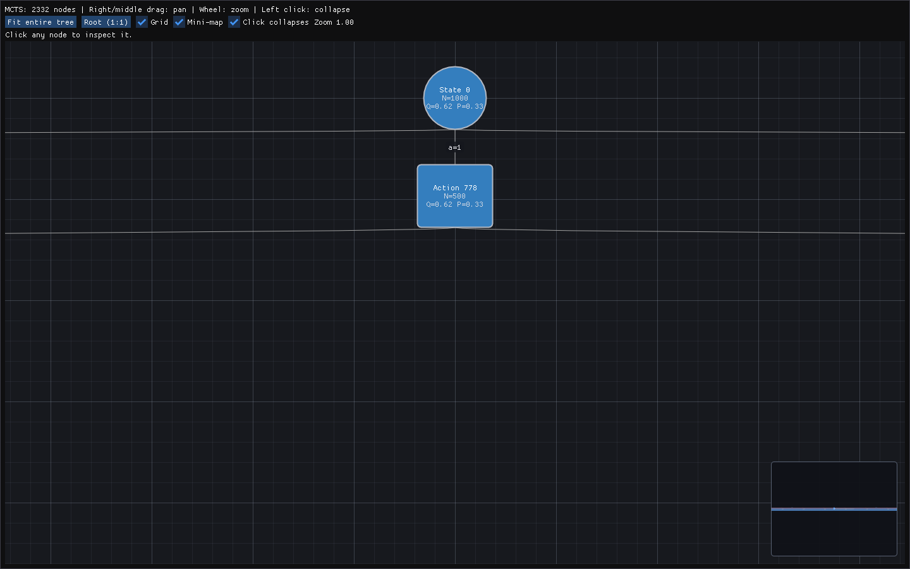

# imgui_tree_graph

Bibliothèque C++20 de visualisation d’arbres de recherche pour Dear ImGui :
MCTS, minimax, décisions et états/actions. Namespace `ImGuiTreeGraph`.



Cette image est une capture PNG de la démo C++ compilée et exécutée avec
Dear ImGui, GLFW et OpenGL (Mesa sous Xvfb), pas une illustration générée.
Elle montre la vue détaillée initiale de l’arbre ; la mini-map représente
l’ensemble de ses neuf niveaux.

## Compilation et démo

Prérequis : CMake ≥ 3.24, Git, compilateur C++20 et pilote OpenGL ≥ 3.2.
CPM.cmake est téléchargé automatiquement (empreinte SHA-256 vérifiée), puis
récupère Dear ImGui **v1.91.9b** et GLFW **3.4**. Il n’est pas nécessaire
d’installer ces deux bibliothèques séparément. La première configuration
nécessite Internet ; `CPM_SOURCE_CACHE` permet de partager le cache.

Sous Debian/Ubuntu, les dépendances **système** de GLFW/OpenGL restent nécessaires :

```sh
sudo apt-get install cmake g++ git libgl1-mesa-dev libxrandr-dev libxinerama-dev libxcursor-dev libxi-dev
cmake -S . -B build -DCMAKE_BUILD_TYPE=Release
cmake --build build --config Release --parallel
ctest --test-dir build -C Release --output-on-failure
./build/imgui_tree_graph_demo
```

Sous Windows : Visual Studio 2022 avec les outils C++, mêmes commandes CMake,
puis `build/Release/imgui_tree_graph_demo.exe`. Sous macOS : Xcode Command Line
Tools ; la démo utilise un contexte OpenGL 3.2 core.

La démo génère un arbre de neuf niveaux, avec états ronds, actions rectangulaires,
alternance des joueurs, nœuds chance, métriques et probabilités.

- Glisser avec le bouton droit **ou central** : déplacement.
- Molette : zoom centré sur le curseur, même dans une fenêtre ImGui déplacée.
- Clic gauche sur un nœud : repliage/dépliage, sans réinitialiser la caméra.
- Clic/glisser dans la mini-map : recentrage de la caméra.
- Boutons « Fit entire tree » et « Root (1:1) » : vue globale ou détaillée.
- `--frames 5` : test de démarrage borné, utilisable avec Xvfb.

### Reproduire la capture du README

Après compilation, sous Linux, installer `xvfb`, `xauth` et `imagemagick`,
puis lancer depuis la racine du dépôt :

```sh
mkdir -p docs/images
xvfb-run -a -s '-screen 0 1440x900x24' sh -c '
  LIBGL_ALWAYS_SOFTWARE=1 ./build/imgui_tree_graph_demo &
  demo=$!
  trap "kill $demo 2>/dev/null || true" EXIT
  sleep 8
  kill -0 "$demo" || exit 1
  import -window root docs/images/imgui-tree-graph-demo.png
'
```

Le PNG est capturé directement sur l’écran virtuel pendant que la démo tourne,
sans redessiner ni reconstituer son interface.

## Intégration

```cmake
set(IMGUI_TREE_GRAPH_BUILD_DEMO OFF CACHE BOOL "" FORCE)
set(IMGUI_TREE_GRAPH_BUILD_TESTS OFF CACHE BOOL "" FORCE)
# Facultatif : utiliser votre cible Dear ImGui existante, plutôt que CPM.
set(IMGUI_TREE_GRAPH_IMGUI_TARGET my_imgui CACHE STRING "" FORCE)
add_subdirectory(external/imtree)
target_link_libraries(my_app PRIVATE ImGuiTreeGraph::imgui_tree_graph)
```

```cpp
#include <imgui_tree_graph/TreeRenderer.hpp>

using namespace ImGuiTreeGraph;
auto root = std::make_unique<BuchheimNode>();
root->primary_label = "Root";
auto child = std::make_unique<BuchheimNode>();
child->shape = NodeShape::RoundedRectangle;
child->secondary_label = "N=42\nQ=0.7";
child->edge_from_parent.label = "p=0.8";
root->add_child(std::move(child));
LayoutConfig layout;
ComputeBuchheimLayout(root.get(), layout);
TreeRenderer renderer; // persistant, un par canvas

// À chaque frame, entre ImGui::Begin(...) et ImGui::End() :
renderer.render("search", root.get(), layout);
```

Les structures possèdent les chaînes (`std::string`) et les enfants
(`std::unique_ptr`). Les pointeurs parent, contours et indices sont non propriétaires
et recalculés par le layout. `add_child` transfère la propriété, refuse un enfant
nul et établit immédiatement son parent et son indice. Un arbre est requis : les graphes avec cycles ou
états partagés doivent être déroulés en occurrences distinctes. Les identifiants
sont des métadonnées ; aucune unicité n’est requise pour le rendu.

Après une modification structurelle ou des paramètres de layout, appeler
`ComputeBuchheimLayout` avant le rendu. Le repliage par le renderer le fait
automatiquement. Pour un arbre neuf, `render` et la surcharge mutable de
`fit_to_tree` calculent le premier layout automatiquement. La surcharge prenant
un arbre constant ne le modifie jamais et cadre ses coordonnées actuelles ;
sur un arbre neuf, ce parcours utilise un stockage temporaire O(profondeur).
Après modification d’un arbre déjà calculé, même via `add_child`, le recalcul
explicite reste nécessaire. Conserver le modèle pendant le rendu, sans modification concurrente.
Les dimensions sont uniformes, en unités monde ; un cercle utilise la plus petite
dimension comme diamètre. `level_height` est la distance entre centres de niveaux :
choisir une valeur supérieure à `node_height` pour laisser de la place aux arêtes.
La racine est ancrée à `(0,0)`. Les bornes incluent les dimensions des nœuds visibles.

`RendererConfig` configure la grille, la taille et les quatre coins de mini-map,
les limites de zoom et les seuils LOD. `camera()` expose pan (pixels locaux du
canvas) et zoom. `fit_to_tree` ajuste la caméra aux dimensions disponibles.
`fill_color == 0` sélectionne `RendererConfig::node_color(node, user_data)` si
ce callback est renseigné, sinon la palette J1/J2/chance. Toute autre couleur
`ImU32` est prioritaire. Le callback et `node_color_user_data` s’appliquent
au canvas et à la mini-map ; ils permettent notamment une palette multi-joueurs.
Le callback ne doit ni modifier l’arbre ni allouer pour conserver les garanties
du rendu.

Après chaque `render`, `renderer.interaction()` expose les nœuds survolé et
cliqué, le bouton, le double-clic, les modificateurs et les positions écran/monde.
Les feuilles sont également sélectionnables. `collapse_on_click = false`
désactive le repliage pour réserver le clic à un inspecteur personnalisé.
Ces événements sont réinitialisés à chaque rendu ; leurs pointeurs empruntés
ne doivent pas survivre aux nœuds. La démo affiche les données du nœud sélectionné.

## Architecture et performances

```text
include/imgui_tree_graph/BuchheimLayout.hpp  modèle et API du layout
include/imgui_tree_graph/TreeRenderer.hpp    caméra, options et API du canvas
src/BuchheimLayout.cpp                      Buchheim–Jünger–Schulz
src/TreeRenderer.cpp                        rendu ImDrawList et interactions
examples/demo.cpp                          GLFW + OpenGL3
tests/                                    régressions layout et rendu
```

Le layout implémente les deux parcours de Buchheim, Jünger et Schulz (2002),
les contours avec fils virtuels et l’accumulation `shift/change` :
**O(N) en temps**, sans recherche linéaire de frère ou copie de contours.
Les recalculs réinitialisent les données temporaires.

Le rendu parcourt les nœuds visibles structurellement en O(N) et ne soumet les
primitives de nœuds/arêtes que si leurs AABB (épaisseur comprise) intersectent
le viewport effectif. Les cartouches sont testés indépendamment. Cela ne constitue
pas un index spatial : le parcours CPU reste linéaire, même lorsque peu de nœuds
sont à l’écran. La mini-map possède son propre viewport.

La bibliothèque ne crée ni conteneur temporaire ni allocation dynamique par frame.
Dear ImGui reste propriétaire de ses buffers de sommets/indices et peut les
agrandir lorsqu’un nouveau maximum de géométrie est atteint ; l’absence
d’allocations s’entend **en régime établi après préchauffage**. La création du
modèle et des chaînes se fait hors rendu. Textes/badges disparaissent par paliers
de zoom et les formes/arêtes sont simplifiées à faible zoom.

### Limites actuelles pour les arbres de recherche

- Le modèle possède ses nœuds, chaînes et vecteurs d’enfants. Copier un arbre
  MCTS dans ce modèle a un coût de mémoire et d’allocations à la construction,
  distinct de l’absence d’allocations du rendu après préchauffage. Il n’existe
  pas encore de pool plat ni d’adaptateur zéro copie vers un arbre externe.
- Le LOD simplifie la géométrie et masque textes/cartouches ; il ne regroupe
  pas les sous-arbres denses en clusters. Le culling évite les primitives hors
  écran, mais pas le parcours des nœuds visibles structurellement, y compris
  pour la mini-map. Il ne garantit donc pas un temps proportionnel au seul
  nombre de nœuds affichés à l’écran.

Avec les indices ImGui 16 bits par défaut, le backend doit annoncer
`ImGuiBackendFlags_RendererHasVtxOffset` (c’est le cas du backend OpenGL3 de la
démo). Sinon, compiler **tout** ImGui et ses consommateurs avec `ImDrawIdx`
32 bits dans `imconfig.h`. Le canvas affiche un diagnostic et refuse le rendu
si aucune de ces conditions n’est remplie, pour éviter les débordements sur les
grandes mini-maps. Le zoom minimal par défaut (`0.00001`) permet de cadrer les
arbres très larges ; une limite personnalisée plus élevée peut empêcher ce cadrage.

## Tests, CI et installation

Les tests sont autonomes (sans framework externe). La CI compile sous Linux,
Windows et macOS, lance les tests, vérifie l’installation et démarre la démo
Linux sous Xvfb/Mesa. Un job Linux utilise AddressSanitizer/UBSan.

```sh
cmake --install build --prefix /your/prefix
```

L’installation fournit les en-têtes, la bibliothèque et l’export
`lib/cmake/imgui_tree_graph/imgui_tree_graphTargets.cmake`. Les consommateurs de
cet export doivent fournir les includes et le linkage de leur propre Dear ImGui,
compilé avec une configuration ABI compatible (notamment `imconfig.h`).
Pour construire la démo avec une cible ImGui externe, renseigner également
`IMGUI_TREE_GRAPH_IMGUI_SOURCE_DIR` vers les sources correspondantes.
